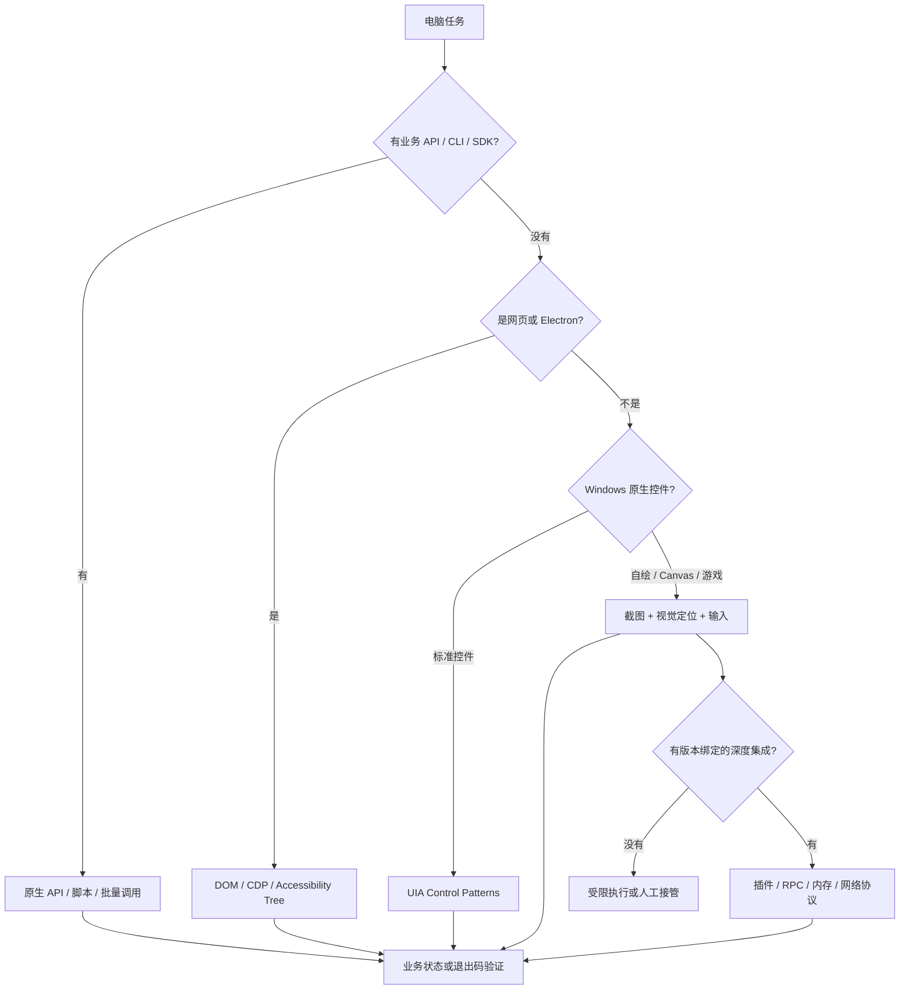
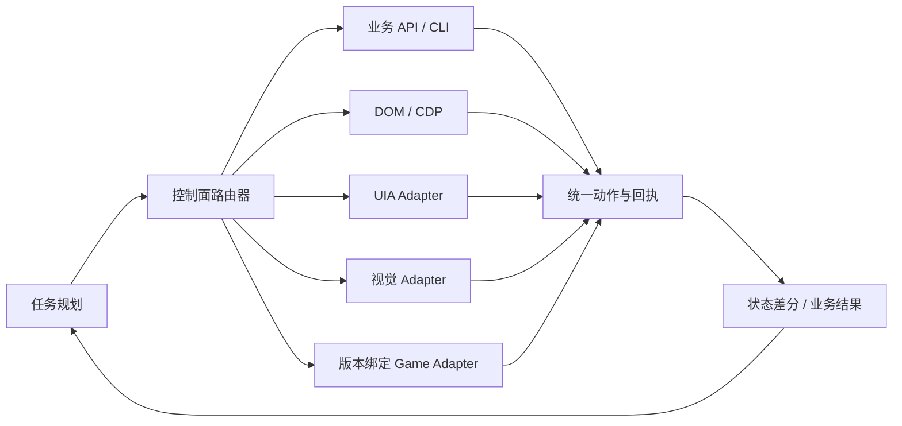

# Computer Use 路线、项目与边界

日期：2026-10-21。本文区分主流 Computer-Using Agent、结构化 UI 自动化、专用 API/RPA 和进程内接入，并说明咕嘎现有 UIA 快速路径的位置。

## 结论

“大规模电脑操作一定不是看图”基本成立；“一定直接改内存”不成立。

真正大批量、稳定的操作优先使用更高层的控制面：

1. 业务 API、CLI、数据库、SDK。
2. 浏览器 DOM/CDP、Playwright、页面内部请求。
3. Windows UI Automation、macOS Accessibility、Android Accessibility。
4. Office COM、应用插件、IDE 扩展、应用自己的 scripting API。
5. Win32 消息、键盘鼠标输入。
6. 进程内注入、内部函数调用、内存结构修改或网络协议重放。

内存修改是最后一类，在游戏和封闭客户端里确实常见，因为外部没有稳定 API，模拟键鼠又可能被忽略或检测。它解决的是“如何绕过 UI 直接改应用内部状态”，不是通用桌面智能体的默认架构。

## 四条控制路线

选择原则是：**能表达任务全部语义的最高层接口优先。**

例如“把 Excel 中的 10000 行按条件汇总”：

- 截图点击是最差路径。
- UIA 可以点击筛选和公式，但仍然逐控件操作。
- Office COM 或 Python/openpyxl 可以批量完成。
- 数据库导入或 pandas 更快。

例如“在网页里创建 500 个条目”：

- 视觉点击每个字段会产生大量截图和模型调用。
- Playwright/DOM 能直接定位元素并批量执行。
- 网站公开 API 或内部请求通常更稳。

例如“在酒馆战棋里购买一张牌”：

- 游戏 UI 可能是自绘的，UIA 看不到牌面。
- 截图能看见牌，但坐标和动画状态容易变化。
- 版本绑定后可以读内存中的实体、商店和合法选项，再由窗口输入或内部操作执行。
- 读取内存比写内存可靠得多；写内存需要同时知道当前版本、对象地址、函数调用和回执。

## 主流项目解读

### Anthropic Computer Use

Anthropic 的 computer use 工具暴露 `screenshot`、鼠标点击、键盘输入、滚动、拖拽和区域放大等动作。宿主应用负责真实桌面或虚拟机执行；模型根据截图和动作结果循环。官方也支持一串 batch action，例如点击、输入、再截图，按顺序执行。

它代表“视觉通用接口”：不要求应用有 API，因此覆盖面广，能操作任意普通界面。官方文档同时列出了几个重要边界：坐标可能幻觉、滚动/表格操作不稳、长任务延迟高、截图历史会快速消耗上下文，复杂任务仍然需要验证和安全提示。

来源：[Computer use tool](https://platform.claude.com/docs/en/agents-and-tools/tool-use/computer-use-tool)。

### OpenAI Computer Use

当前 OpenAI Agents API 的 Computer use 文档把任务放在 OpenAI-hosted browser 中：应用创建浏览器会话、发送任务、跟随事件、处理网站访问请求，最后验证结果并清理会话。它主要是浏览器界面操作，并非“任意 Windows 进程内存控制”。

这体现了一个常见产品取舍：把执行环境放在托管浏览器里，容易做隔离、审计和清理，但控制面比本地整台电脑窄。

来源：[OpenAI Computer use](https://developers.openai.com/api/docs/guides/agents-api/tools/computer-use)。

### Microsoft UFO² / Windows AgentOS

UFO² 是 Windows 领域最接近咕嘎方向的项目。它明确反对只靠截图和模拟输入，采用：

- `HostAgent` 负责跨应用分解、选择应用和协调顺序。
- `AppAgent` 负责单应用中的控件、API 和具体动作。
- Windows UIA 获取标准控件树。
- Win32 做窗口和进程管理。
- WinCOM 连接 Office。
- 应用内省和专用 API 处理 GUI 看不到的状态。
- 视觉识别作为自绘控件或未知界面的回退。
- MCP server 统一暴露 GUI/API 动作，并在虚拟桌面运行自动化。

它的核心价值是把“应用操作系统 abstractions”变成 HostAgent/AppAgent/动作层，而不是让一个视觉模型从 Windows 桌面一路点到底。

来源：[UFO² overview](https://github.com/microsoft/UFO/blob/main/documents/docs/ufo2/overview.md)。

### Agent S / Agent S2 / S3

Agent S 是开源 GUI agent 框架，目标是不依赖每个应用的 API，通过屏幕、鼠标、键盘和滚动像人一样操作。它的价值是研究通用视觉策略、跨应用迁移、经验记忆和搜索；适合陌生 UI 和 benchmark。它的边界也是视觉 CUA 的边界：界面变化、长任务步数、上下文成本、动作验证和模型延迟。

来源：[Agent S](https://github.com/simular-ai/Agent-S)。

### UI-TARS / UI-TARS Desktop

UI-TARS 是视觉语言模型驱动的 GUI agent。模型输出结构化动作，例如点击框、输入、滚动；桌面端使用本地 operator 把动作转换为键鼠。它的重点是 GUI grounding、推理和跨桌面/移动设备的泛化，适合没有 API 的应用。

它同样需要截图和坐标，因此适合“通用但未知”的场景；对高频、重复、海量操作并不是最优接口。官方文档也列出误识别、资源占用和长任务幻觉等限制。

来源：[UI-TARS](https://github.com/bytedance/UI-TARS)。

### Browser Use / Playwright MCP

浏览器 agent 的主流路线是读取 DOM 或 Accessibility Tree，给每个可交互元素分配引用 ID，然后执行“点击 e17”“填入文本”这样的结构化操作。Playwright MCP 官方明确说默认使用 accessibility snapshots 而不是截图；截图只是用于布局理解或视觉回退。

这比桌面视觉更稳定，因为浏览器 DOM 本身就是应用的语义模型。边界是只适用于浏览器和部分 Electron 应用，页面动态更新、iframe、Shadow DOM、登录和反自动化仍要处理。

来源：[Playwright MCP snapshots](https://playwright.dev/mcp/snapshots)、[Browser Use](https://github.com/browser-use/browser-use)。

### Magentic-UI

Magentic-UI 强调 human-in-the-loop：共同规划、共同执行、人工接管、高风险动作审批、答案验证和多任务。它不是最激进的“全自动桌面控制”，而是研究如何把人类放在计划和检查点里。

这对咕嘎很 relevant：语音执行的优势是低摩擦，但越接近不可逆操作，越需要可见的计划和动作审批，而不是仅靠模型说“我确认过了”。

来源：[Magentic-UI](https://www.microsoft.com/en-us/research/blog/magentic-ui-an-experimental-human-centered-web-agent/)。

### OSWorld / OSWorld 2.0 / Windows Agent Arena

这些 benchmark 把真实桌面任务放在虚拟环境里，检查最终文件、应用状态或网页结果，而不是让模型自评。OSWorld 的任务覆盖文件 I/O、多个桌面/网页应用和跨应用流程；Windows Agent Arena 专注 Windows 任务。它们揭示了视觉 CUA 的核心工程问题：长期任务的模型调用和反思会导致后续步骤越来越慢，截图上下文也会越来越大。

来源：[OSWorld](https://os-world.github.io/)、[Windows Agent Arena](https://microsoft.github.io/UFO/benchmark/windows_agent_arena/)。

## 控制接口的边界

| 路线 | 速度 | 通用性 | 稳定性 | 主要失效方式 | 验证方式 |
|---|---:|---:|---:|---|---|
| 业务 API/CLI | 最高 | 低，需要适配 | 高 | 权限、API 不可用 | 返回值、业务查询 |
| DOM/CDP | 高 | 网页 | 高 | 动态节点、iframe、反自动化 | DOM/网络/业务状态 |
| UIA | 高 | Windows 标准控件 | 中高 | 自绘 UI、虚拟列表、provider 缺失 | 属性/事件/再观察 |
| 视觉截图 | 低到中 | 最高 | 中低 | 坐标、遮挡、动画、分辨率 | 新截图 |
| Win32 输入 | 中 | 高 | 中 | 焦点、被忽略、权限不同 | 日志/截图/UIA |
| 进程内 API/插件 | 很高 | 极低，版本绑定 | 高但脆弱 | 版本、线程、对象生命周期 | API 返回/内部状态 |
| 内存读取 | 很高 | 极低，版本绑定 | 中 | 偏移、ASLR、结构变化 | 与日志/截图交叉校验 |
| 内存写入/函数调用 | 很高 | 极低 | 低 | 崩溃、竞态、服务器拒绝、反作弊 | 游戏内状态与服务端回执 |

“稳定”不是接口越低越稳定。恰恰相反，越高层的接口越能表达语义并返回可验证结果；底层接口只是绕过了 UI，但仍要自己处理状态、并发和版本。

## 当前咕嘎 UIA 与完整 Computer Use 的区别

咕嘎现在的 UIA 快速路径实现是：

1. `computer.accessibility` 读取目标窗口的前 150 个 UIA 元素，返回 Name、AutomationId、ControlType、bounds。
2. `computer.uia` 用精确 Name/ID/Type 查找元素。
3. 按钮优先调用 `InvokePattern` 或 `SelectionItemPattern`；输入框优先 `ValuePattern`；也可以 `SetFocus`。
4. 如果没有可用 pattern，回退到控件中心鼠标点击。
5. 执行后返回 `needs_observe=True`，必须重新读取控件或截图验证。

这已经不是纯看图，但仍然是一个**单点 UIA 工具**，不是完整 AgentOS：

- 每次重新遍历，尚未缓存窗口控件树和稳定 node ID。
- 没有监听 UIA 事件或等待某个属性变化。
- 没有完整的表格、树、列表、菜单、虚拟滚动和 combo box 操作策略。
- 没有把 screenshot 和 UIA 节点做稳定对应。
- 没有应用专用 API provider，例如 Excel COM、VS Code 协议、浏览器 CDP。
- 没有多窗口并行的输入所有权和事务回滚。
- 只有 Windows UIA，没有 macOS Accessibility 或 Android。

它适合“标准按钮、编辑框、菜单和设置页”，速度比视觉路径快；遇到 Canvas、自绘游戏、Chromium 内部无暴露控件、图片按钮或不支持 UIA 的 Electron 窗口，仍然需要视觉或应用协议。

## 如果真的要接内存操作

内存路线本身也分几种，不应混成一个“读内存/改内存”按钮：

| 层级 | 行为 | 典型用途 | 需要的证据 |
|---|---|---|---|
| 只读快照 | 读取对象和字段 | HUD、状态校验、日志补充 | 进程权限、结构校验、与日志交叉验证 |
| 进程内函数调用 | 调用游戏已有方法和参数 | 购买、出牌、结束回合 | 方法入口、参数 ABI、线程上下文、服务端回执 |
| 写入状态 | 直接改血量、金币、实体 | 调试、单机实验 | 字段绑定、锁、生命周期、回滚 |
| 网络协议 | 重放或构造服务端请求 | 需要服务端接受的游戏操作 | 协议版本、加密、会话、重放防护 |

对炉石这种客户端，读内存已经被 HDT/HearthMirror 用来读取棋盘、账号和卡牌状态；它是只读辅助，不等于能执行买牌。直接执行动作通常还需要事件来源、目标 context、客户端 SendOption 或服务器状态确认。

来源：[HearthSim 关于 Companion 的只读内存说明](https://help.hearthsim.net/en/articles/8377705-how-does-the-untapped-gg-companion-work)、[HearthMirror RPC 架构说明](https://deepwiki.com/HearthSim/Hearthstone-Deck-Tracker/1.1-system-architecture)。

## 对咕嘎的推荐架构

下一步优先做：

1. UIA 树缓存和节点引用，减少每次 PowerShell 重新遍历。
2. UIA 事件监听和等待 predicate，例如等待窗口标题、按钮 enabled、文本框 value 变化。
3. 应用适配器注册表：Excel/Word 用 COM，浏览器用 CDP，IDE 用扩展或文件操作，Windows 通用控件用 UIA。
4. 每条动作带 `before_state`、`after_state` 和 verification result，而不是只回 `input_sent=True`。
5. 游戏内存适配器只处理固定版本、只读优先、方法调用受控、每个动作有日志回执。

这条路线比“全桌面视觉点击”更快，也比“到处改内存”更容易维护。
