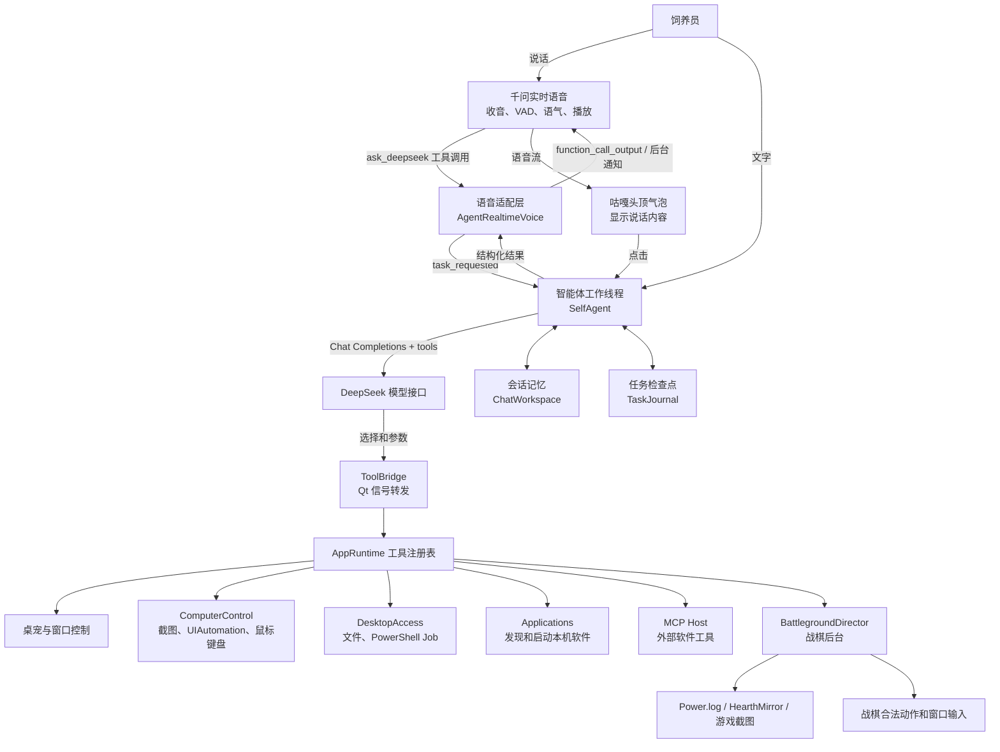
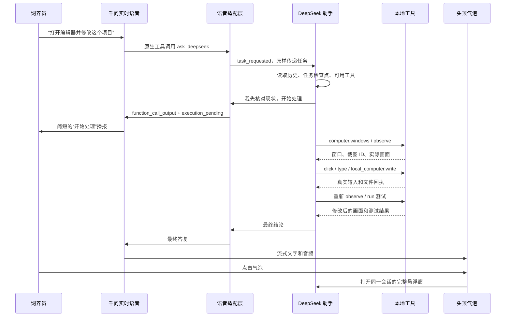
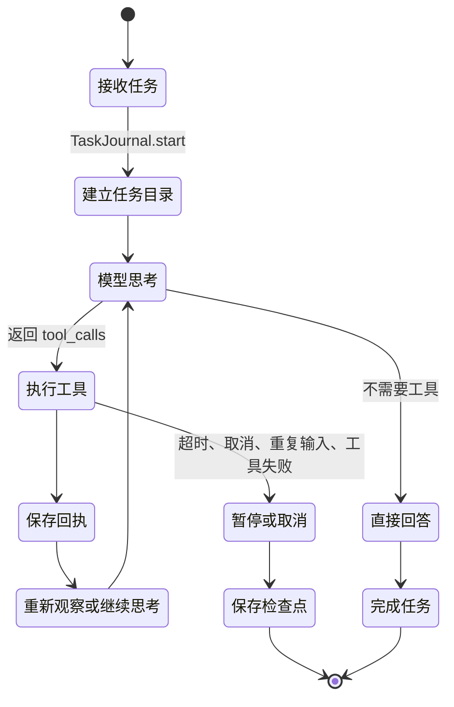
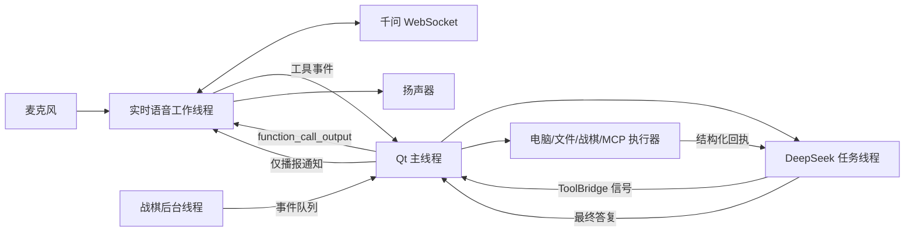
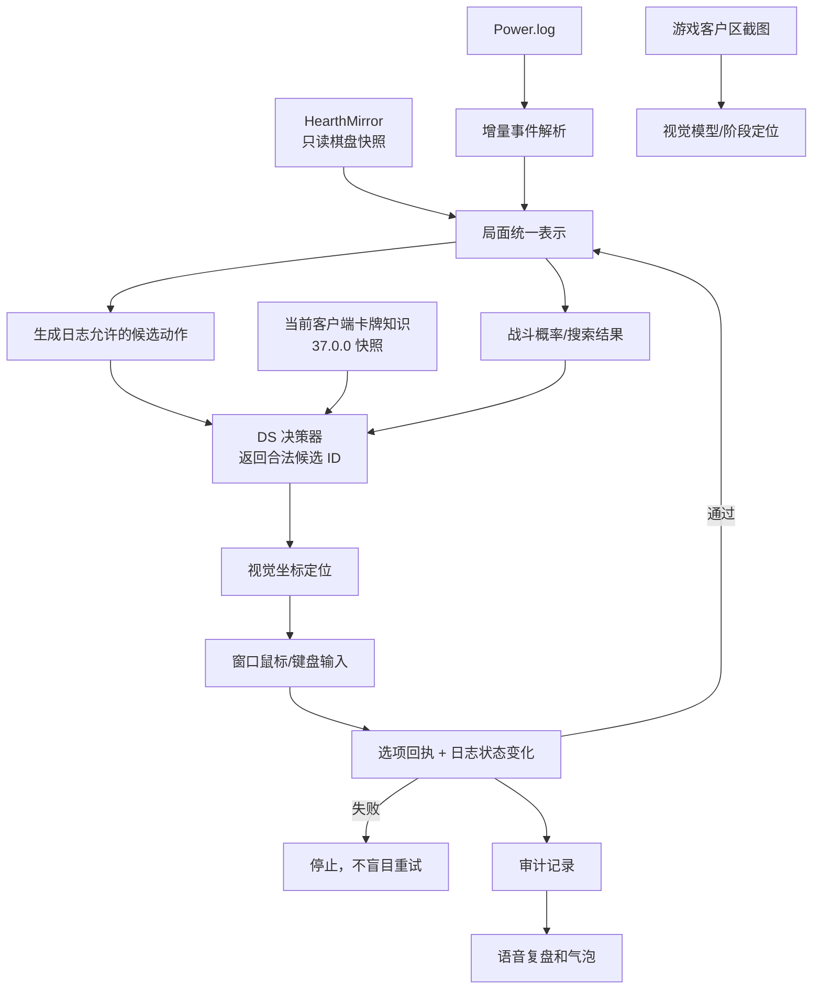
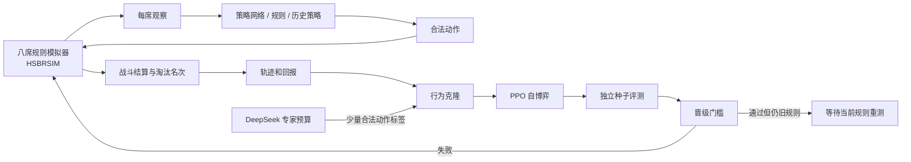

# 咕嘎智能体设计思路：从长语音到本机执行

本文按 2026-10-21 的当前代码说明咕嘎是怎样工作的，并区分“已经验证的能力”“已有代码但仍受限的能力”“尚未完成的目标”。目的不是把每个文件讲一遍，而是让你理解一条任务从声音进入、被拆成工具操作、落到电脑上、再回到气泡和语音的完整链路，从而能复刻一个同类的桌面智能体。

## 先用大白话理解

咕嘎可以看成五个部分：

| 人身上的比喻 | 咕嘎里的东西 | 负责什么 |
|---|---|---|
| 脸和表情 | PyQt 桌宠、悬浮对话窗、头顶气泡 | 显示状态、接收点击、呈现回答 |
| 耳朵和嘴 | 千问实时语音 WebSocket | 持续收音、判断说话轮次、直接生成自然语音 |
| 会思考的大脑 | DeepSeek 助手循环 | 理解任务、选择工具、读取结果、决定下一步 |
| 手和脚 | 桌面控制、文件命令、应用启动、MCP | 点击、输入、读写文件、运行命令、调用其他软件 |
| 专项本能和训练场 | 战棋后台、日志解析、视觉定位、八席模拟器 | 专门处理酒馆战棋和训练策略 |

它不是“一个模型包办一切”。实际是一个**快模型负责听说，强模型负责任务，工具负责真实副作用，执行器负责核对，记忆负责续接**的分层系统。

## 总体架构

这张图里最值得复刻的并不是某个模型，而是中间三条边界：

1. **语音模型负责自然交流，任务模型负责规划**，避免一个实时语音模型既要低延迟聊天又要完成几十步桌面任务。
2. **模型只能提出工具调用，真实操作由本地执行器完成并返回结果**。模型说“已完成”不算完成，必须有执行回执。
3. **界面、工作线程、游戏后台分开运行**。长任务不能阻塞 Qt 主线程，停止和取消也必须能穿透到执行器。

## 一条语音任务到底怎么走

这里用的是“快接一声、后台继续做”的交互。语音模型先简短回应，后台任务继续执行；执行器通过进度事件把“正在打开窗口”“正在写文件”“正在跑测试”推回同一通电话。用户可以在任务执行时问“做到哪了”，也可以追加要求或明确说停止。

代码中对应 `core/realtime_agent.py` 的 `AgentRealtimeVoice` 和 `ui/agent_chat.py` 的 `_voice_request`。前者处理千问工具事件，后者把任务交给同一个 `SelfAgent`。

## 大脑：一个受预算限制的工具循环

`core/self_agent.py` 是最像通用智能体的部分。它的工作方式不是先输出一大段计划然后盲目执行，而是：

它有几条关键设计：

- 同一会话继续使用历史，最多带最近 40 条用户和助手消息，避免上下文无限膨胀。
- 单任务默认最多 15 分钟、80 轮模型思考和 160 次工具操作；到预算会保存检查点。
- 执行过程中新说的话进入 `steering` 队列，当前工具返回后合并到下一轮，而不是丢弃。
- 明确说停止、结束通话或关闭窗口会设置取消事件；已经完成的外部副作用不能假装撤销。
- 相同输入连续出现四次会强制停下，避免模型陷入“点不到就继续点”的死循环。
- 旧工具输出会被截短，检查点和审计记录做密钥字段脱敏；截图进入模型上下文但不写入任务日志。
- `self_ask` 是一次有限的自问，子模型没有工具，最多一次，不会递归创建另一个执行者。

### 工具列表就是产品能力边界

当前模型可看到的工具包括：

| 工具 | 用途 | 真实作用边界 |
|---|---|---|
| `computer` | 列窗口、聚焦、截图、UIAutomation、点击、拖动、滚动、快捷键、中文输入 | 每次输入必须引用最近 30 秒的观察 ID，并核对前台窗口 |
| `local_computer` | 列目录、读文件、写文件、跑 PowerShell | 写入有备份和语法检查，命令有超时、取消、输出限制和 Job Object 清理 |
| `applications` | 查找并启动软件 | 启动请求不等于完成软件内部任务 |
| `battleground` | 打开/观察/分析/有限操作战棋 | 日志合法候选、视觉定位、执行后回执，不能任意点击 |
| `task_plan` | 写计划、进展和检查点 | 让长任务可观察、可续接 |
| `pet_control` | 移动、显示、动画、音量、窗口等 | 只控制咕嘎自身 |
| `workspace` | 项目与会话管理 | 不存 API Key |
| `ecosystem` | 通过 MCP 调用外部软件 | 只调用用户配置且授权的工具 |
| `self_ask` | 让无工具的分析副本检查一个问题 | 只分析，不执行 |

这就是“权限最高”的实际含义：完整访问模式下，模型可以通过工具读写文件和运行本机命令；它继承的是咕嘎进程的 Windows 权限，不是凭空给任意进程提权。当前本机若以管理员启动，工具就继承管理员权限。

## 手和脚：真实操作如何做

### 看屏幕和操作窗口

`core/computer_control.py` 采用观察→输入→再观察的闭环：

1. 列出前台窗口，找到目标标题或句柄。
2. 聚焦目标窗口并截取客户区，返回窗口尺寸和观察 ID。
3. 需要理解控件时，用 Windows UIAutomation 读取可访问文本结构。
4. 点击或输入前验证：观察未过期、前台仍是同一窗口、坐标没有越界。
5. 输入后清掉旧观察 ID，要求重新截图核对，不把“鼠标已发送”当成任务成功。

这种设计适合编辑器、浏览器、普通桌面软件。它仍然依赖界面状态和软件是否接受合成输入，不能保证所有游戏或受保护软件都能被自动化。

### 文件和命令

`core/desktop_access.py` 给模型提供受控的本机动作：

- `write` 覆盖已有文件前写到 `runtime/self-updates/` 备份；Python/JSON 先检查语法。
- `run` 默认在独立任务目录运行 PowerShell，单次最多 300 秒。
- Windows Job Object 保证取消或超时时连子进程一起结束，避免后台残留。
- 输出有大小上限，常见 `api_key`、`authorization`、`password` 等字段在日志中脱敏。

“咕嘎可以优化自己”靠的就是读取源码、使用备份写入工具修改、运行测试、看回执。它不会自动改变模型权重；Python 源码修改通常要重启咕嘎才生效。

### 外部软件 MCP

`core/mcp_host.py` 用 stdio 启动用户配置的 MCP 服务，再通过 `tools/list` 和 `tools/call` 操作外部软件。这样咕嘎不需要把每个应用的 API 都硬编码，只要该软件提供 MCP 工具。

`tools/guga_mcp_server.py` 反过来也把咕嘎暴露给别的 MCP Host，通过当前用户专属命名管道进入同一个 `AppRuntime`。

## 头顶气泡为什么能做到

`ui/speech_bubble.py` 是独立于对话窗的 `QFrame`：

- 无边框、透明背景、置顶、不抢焦点。
- 它监听咕嘎的位置，跟随移动；靠近屏幕上边缘时自动放到咕嘎侧面。
- 千问返回流式转写时，气泡显示前 220 字；完整内容仍在会话数据库中。
- 通话开始显示“我在听”，说话时显示“正在回答”，结束显示“通话已结束”。
- 点击气泡发出 `clicked` 信号，桌宠打开同一个 `conversation_id` 的悬浮对话窗。

这不是把整个聊天窗口缩小，而是一个只负责“显示和点击跳转”的轻量提示层。音频生命周期仍由实时语音引擎管理，气泡不保存麦克风和 WebSocket。

## 长语音和后台任务的并发设计

关键规则：

- 所有模型/工作线程都不能直接改 Qt 控件，必须通过 `pyqtSignal` 回主线程。
- 千问的 function call 按 `call_id` 去重，避免“参数生成完”和“响应结束”两条事件执行两次。
- 普通语音打断只停止播放和旧播报，不应无条件杀死仍在运行的授权任务；明确停止、结束通话、关闭窗口才取消后台任务。
- 后台进度通知只在用户没说话、当前没有生成、没有播放时插入；通知中的模型工具调用会被拒绝，避免“播报一条复盘又误启动新动作”。
- 排队通知有过期时间，打断会递增 epoch 清掉旧通知，防止用户已经换话题后旧任务还突然说话。

## 战棋专项层

通用桌面控制能点按钮，但不代表会下棋。战棋需要一个专门的状态机和训练闭环：

### 当前已经做到的部分

- 从日志增量读取实体、区域、位置、攻击、生命、金币、酒馆等级、候选选项和阶段。
- 在明确战斗阶段拒绝招募输入。
- 模型只能从候选 `action_id` 里选，不允许自由编造一个动作 ID。
- 视觉模型只负责把选中的动作映射到画面坐标，并检查阶段和置信度。
- 执行后要求看到 `GameState.SendOption` 和相应状态变化；没有双回执就停止。
- 后台任务有步数、时间、会话绑定、停止锁和新对局检测。
- 本轮当前卡牌快照为 37.0.0，可帮助模型知道名称、种族、基础数值和卡面文本，但实际局面数值优先。

### 尚未完成的部分

- **真正写入内存并调用游戏函数**没有验证；现在内存路径是只读 HearthMirror 快照，而且曾出现空棋盘。
- 旧规则引擎仍缺一批当前池卡牌脚本，不能把它冒充完整当前规则。
- 发现、目标选择、站位联动、英雄技能、饰品、畸变、酒馆法术轮换等没有完整覆盖。
- 真实管理员实例的连续买牌、出牌、升本和整局回执仍需现场验收。
- 视觉点击是最后一步辅助，不能代替结构化状态和执行回执。

## 八席模拟器：它究竟在训练什么

这里最容易误解的一点是：**八个席位不等于八个大模型**。通常是四席共享当前策略、两席规则策略、两席冻结历史策略；云端 DS 只是少量专家标注，每个席位每回合最多请求一次，且有全局请求预算和台账。这样才可能在本地进行大量对局。

训练顺序是：规则对手产生示范→行为克隆预热→PPO 用终局名次训练→独立种子评测。当前报告中的 128 局独立复测显示旧规则实验室冠军有改善，但 manifest 明确 `live_adapter=not enabled`，因为规则仍是旧快照，不能直接当成实服棋力。

## 炉石盒子逆向到底有没有提升 AI

直接回答：**目前没有把盒子的 AI 能力并入咕嘎，也没有测到可证明的棋力提升。**

逆向得到的是工程线索，不是现成算法：

- 盒子安装包和辅助程序里发现了命名管道、Qt/CEF、匹配服务和保护模块；这些说明它有自己的数据/通信体系，但没有还原出胜率算法。
- 发现匹配服务导出 `requestMatch`、`gameStart` 等符号，不足以证明存在第三方可调用的 AI 下棋接口。
- 在 HDT 对照中定位了 BobsBuddy 的 `SimulateForInput`、`SimulateFight` 和输入/输出结构；这对下一阶段接战斗评估有价值，但它是 HDT 的独立组件，不是盒子内核。
- 盒子主体有高熵保护段，现有证据不足以复制其策略；也没有证据表明它的 AI 接口可以合法稳定地给咕嘎调用。

所以逆向的收益是：知道该观察什么、该避开哪些假设、为日志局面、战斗模拟和动作回执提供了方向。它没有让当前 DS 决策器自动变强。

## 如果要复刻，最小可行版本

### 第 1 层：会说会显示

先做桌宠、悬浮对话窗、TTS/实时语音、会话数据库。不要一开始就做自动操作。验收点是：同一句话能显示、能朗读、能打断、重连后旧回答不重复出现。

### 第 2 层：会调用工具

给模型一个严格 JSON schema 的工具表，先只做 `open_app`、`read_file` 两个只读/低风险工具。实现模型→工具→回执→模型的循环，再做取消和超时。验收点是：模型不能直接改 Qt 控件，所有真实操作都有返回值。

### 第 3 层：会看和会动

加入窗口列表、客户区截图、UIAutomation、点击、输入。关键不是“能点”，而是“点前有观察 ID，点后有新截图”。验收点是：前台窗口变化或坐标过期时拒绝输入。

### 第 4 层：能续接长任务

加入 `TaskJournal`、独立工作目录、80 轮/160 操作/时间预算、steering 队列、检查点和重启后的“继续”。验收点是：中途追加要求不丢、停止后不再发送输入、重启不重放副作用。

### 第 5 层：专项智能

战棋先做只读日志重放和固定局面回放，再做战斗概率校准，最后接执行器。不要从“直接让模型点屏幕”开始。专项层必须有自己的状态结构和动作合法校验。

### 第 6 层：训练和晋级

先有可复现模拟器和评测集，再做 BC/PPO。模型权重只有在当前规则、独立种子、对手池和置信区间都达标后才能进入实战；否则只输出建议。

## 建议怎么提高 AI 实力

优先级从高到低：

1. **把局面理解做准**：日志重放逐帧对账，内存读取和日志实体交叉核对，建立固定局面测试集。现在评估低的原因是状态和规则不可靠时，模型再聪明也会基于错误局面决策。
2. **把战斗胜率做准**：优先接可验证的 HDT/BobsBuddy 或成熟规则引擎，先测校准误差和战斗结果分布；不要用简化掷骰或模型“感觉”冒充胜率。
3. **把买牌和站位变成搜索问题**：对每个合法候选推演一步或几步，用战斗引擎回滚评估，比较当前战力、经济、三连和未来阵容收益。大模型负责意图和解释，搜索器负责计算。
4. **建立动作数据飞轮**：记录 `局面代次 → 候选动作 → 模型选择 → 执行回执 → 战斗结果`。先模仿人类/HDT 回放，再自博弈，最后用独立场景测试晋级。
5. **补齐当前规则**：当前池仍有大量卡牌没有脚本，先把规则覆盖率和每张卡的回归清单做出来；没有规则就没有可信的自博弈奖励。
6. **真正打通内存执行，但分阶段验证**：先只读、再在单步受控窗口写入/调用、再做连续动作；每一步都要有日志回执。没有幂等和回滚就不要自动连点。
7. **保留模型分工**：千问只管听说，DeepSeek 管规划，视觉模型管定位，本地策略管高频决策，规则引擎管胜负判定。把全部任务塞给一个云端大模型，会既慢又难验证。

### 每次升级应该看的指标

| 指标 | 为什么看它 | 最低验收方式 |
|---|---|---|
| 局面字段准确率 | 错一个实体就会点错 | 固定日志重放逐实体对账 |
| 候选合法率 | 模型不能凭空造牌 | 100% 来自日志候选 |
| 动作双回执率 | 鼠标发出不等于成功 | SendOption + 状态变化 |
| 战斗概率校准 | 胜率要能预测结果 | Brier 分数、校准曲线、实际战果回放 |
| 每局平均名次/前四率 | 衡量长期策略 | 独立种子、配对 bootstrap、多种对手 |
| 工具完成率/超时率 | 通用智能体可靠性 | 可取消、可复查、无重复副作用 |
| 语音首响应和打断 | 长语音体验 | 真实麦克风和扬声器验收 |

## 用一句话总结复刻方法

先做一个**能记住同一条会话、能调工具、每次操作都有回执、能停止和续接**的桌面智能体；再给它接上**实时语音和气泡**；最后把战棋拆成**日志观察、合法候选、战斗评估、受限执行、离线训练、独立晋级**六层。模型只是其中一层，真正决定实力的是状态质量、规则覆盖、搜索能力和评测闭环。
