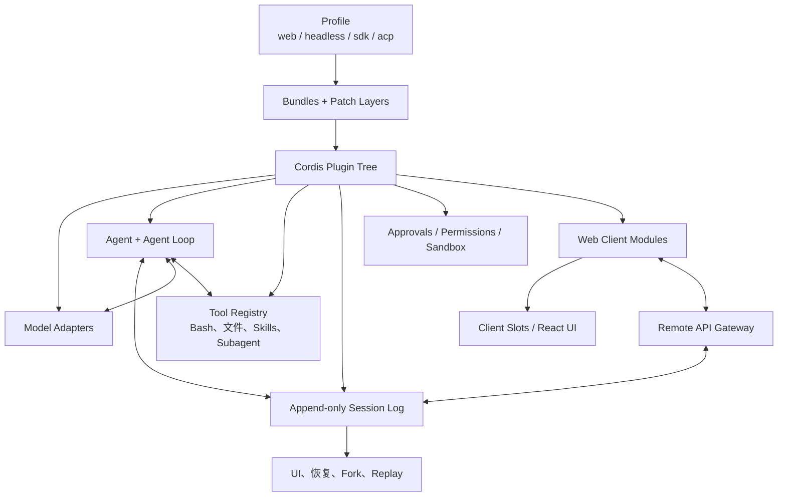
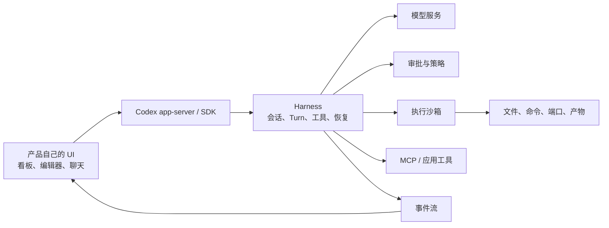
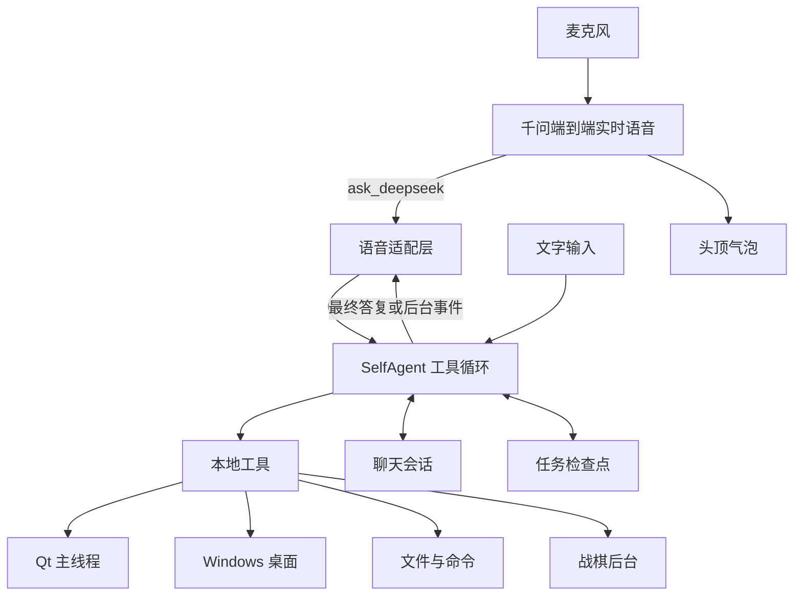
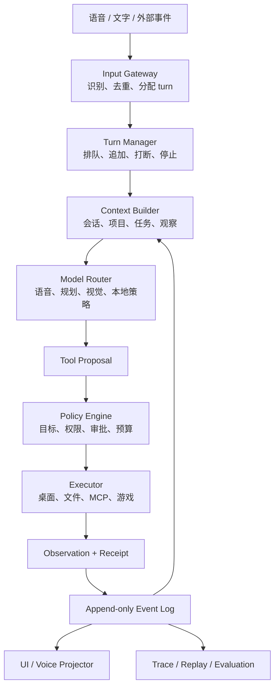
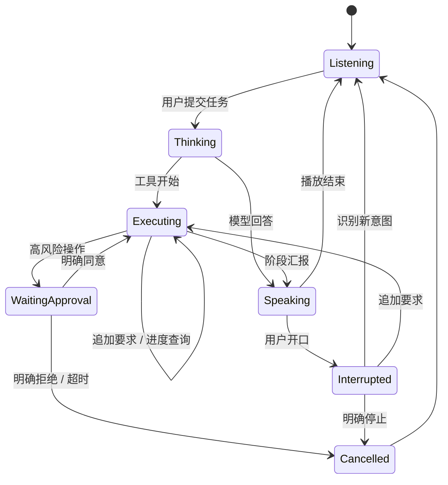
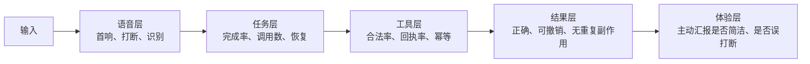

# 实时语音智能体的 Harness 设计与优化路线

本文讨论的是“咕嘎为什么能做到边说边执行”和“DSH、Codex 为什么把语音做成可选层”，并给出一套适合咕嘎后续开发的 harness 路线。这里把 `dsh` 理解为 DeepSeek Harness。

## 先说结论

咕嘎与一般代码智能体最大的不同，是它把**实时听觉、自然语言播报、桌面执行器和主动通知**放在同一条用户会话里。一般代码智能体把**持久会话、可审查步骤、工具审批和执行环境**放在中心，文本输入和可视界面更适合代码、文档、差异和审批。

底层 agent loop 其实并不神秘：读取上下文，调用模型，解析工具调用，执行工具，把结果写回上下文，再进入下一步。真正拉开工程质量的是 loop 外面的 harness：

- 会话和事件如何持久化。
- 工具如何声明、授权、执行、取消和验证。
- 上下文从哪里来、何时压缩、如何续接。
- 用户输入是排队、打断还是取消任务。
- 模型、执行器和 UI 如何分离。
- 失败后能否重放、恢复和评测。

因此可以用一句话理解：**模型决定“下一步想做什么”，harness 决定“这件事能否被可靠、可审计、可停止地做成”。**

## DSH 的架构

DSH 的官方定位是一个开源的 agent harness，核心思想是“everything is a plugin”。



它有几条很值得学习的设计：

1. **Profile 决定最终组合。** `web`、`headless`、`sdk` 和 `acp` 不是四套代码，而是不同插件与补丁层组合出来的运行模式。
2. **没有不可替换的特权内核。** 模型适配器、工具注册、会话日志、甚至 agent loop 都能由插件提供。
3. **会话日志是唯一事实来源。** 模型历史从日志投影得到；恢复、Fork、回放、持久化都从同一份事件记录推导。
4. **Turn、Step 和 Event 分清。** 一个 Turn 是用户开始一段任务到没有待处理输入为止；Step 是一次模型请求及其工具调用。中途的输入、模型流、工具调用和结果都是事件。
5. **Host 与 Client 分离。** Host 拥有权威状态、持久化、策略和变更顺序；Web Client 通过 Remote API 获取状态和流，再组合 UI。
6. **UI 也是插件树。** Client Modules 负责加载插件，Slots 负责组件插入，Conversation 把会话历史投影成各类视图。
7. **语音是可选能力。** 官方语音输入采用 Service Definition、本地或云端 Provider、浏览器 Consumer 三层。浏览器只拥有麦克风和草稿，Host 管理识别；转写文本本身不写入会话，只有用户正式提交才形成模型可见消息。

这套设计的优势是稳定、可替换和可回放；代价是层次多，新增一个语音模式需要跨 Host、Client、传输、模型和持久化设计。

官方资料：[DeepSeek Harness 仓库](https://github.com/deepseek-ai/deepseek-harness)、[DSH 架构](https://deepseek-harness.github.io/deepseek-harness/en/reference/)、[Web Client 架构](https://deepseek-harness.github.io/deepseek-harness/en/reference/subsystems/web-client)、[官方语音输入子系统](https://github.com/deepseek-ai/deepseek-harness/blob/master/docs/subsystems/voice-input.md)。DSH 仍在 developer preview，内部接口可能变化。

## Codex 类智能体的架构

Codex 的公开组件同样把“模型”和“harness/执行环境”分开。OpenAI 官方描述中，harness 管理会话状态、流式执行、工具、沙箱与审批策略、跨轮任务；Codex app-server 通过线程、Turn 和事件把能力暴露给产品 UI。Agents API 的架构还明确把 control plane 和 compute plane 分开：harness 管理 loop、工具路由、审批、追踪和恢复，sandbox 负责文件、命令和端口。



这和 DSH 在思想上很近：会话和工具是核心，UI 是可替换的，执行环境有明确的权限边界。差别在侧重点：

- Codex 强调整合进开发工作流和代码执行环境。
- DSH 强调插件组合和会话事件的可重建性。
- 咕嘎强调实时语音、桌宠人格、主动播报和通用 Windows 操作。

官方资料：[Codex as a platform](https://developers.openai.com/blog/codex-as-a-platform)、[Agents API 架构](https://developers.openai.com/api/docs/guides/agents-api/architecture)、[Sandbox Agents](https://developers.openai.com/api/docs/guides/agents/sandbox)、[Guardrails and human review](https://developers.openai.com/api/docs/guides/agents/guardrails-approvals)。

## 咕嘎当前的架构特点



与 DSH/Codex 相比，咕嘎当前的差异是：

| 维度 | 咕嘎 | DSH / Codex 型 |
|---|---|---|
| 主入口 | 持续语音，说话即可下任务 | 键盘、代码、产品界面为主 |
| 使用者状态 | 手可能正忙，希望边做边聊 | 通常坐在编辑器和工作区前 |
| 反馈 | 语音、气泡、主动汇报 | 对话流、工具卡片、diff、审批 UI |
| 副作用 | 直接操作桌面、文件、软件 | 多数在受控工作区或明确审批后执行 |
| 持久化 | SQLite 会话 + 任务检查点 | 追加式事件日志和会话快照 |
| 可组合性 | 项目内硬编码工具和 UI 路径 | Host/Client、插件、profile、schema |
| 恢复 | 检查点、有限任务预算 | Turn/Step/Event 级恢复和重放 |
| 语音模型 | 直接接入会话和任务通知 | 语音作为输入或输出插件 |
| 优势 | 低摩擦、人格感、实时反馈、通用桌面 | 可审查、可回放、权限边界清楚、可扩展 |
| 风险 | 语音歧义、事件耦合、回放较弱 | 配置复杂、键盘入口、自然感较弱 |

咕嘎的强项来自“入口和反馈非常短”：说一句话就进入同一会话，后台执行时还能插话，说完后气泡和语音立即回馈。它的弱项来自 harness 还没有完全分层：会话数据库、任务文件、战棋事件、语音通知和 Qt 状态各自存在，跨层 trace 不够统一。

## 为什么通用智能体不默认做成咕嘎这样

### 1. 语音是弱结构输入

代码和文件操作需要精确路径、参数、差异、审批。语音很容易出现同音词、指代不清、多人说话和背景噪音。将语音先转成草稿，让用户确认后再提交，能显著降低误操作。

### 2. 会话真值需要可重建

DSH 把会话日志作为模型上下文的唯一来源。若每个临时音频片段、识别候选和语音播报都直接变成用户消息，恢复后的会话很难与原会话一致。官方语音输入因此只把转写放进草稿，正式提交才进入会话。

### 3. 副作用需要审批和可见性

文本界面可以先显示工具参数、目标文件和 diff，再等待确认。语音界面显示能力有限，审批还容易被“嗯”“好”或误识别当成同意。全双工语音需要专门设计：确认是回应哪一次操作、是否能在播放中途打断、用户说“继续”时是否属于旧任务。

### 4. 实时音频工程很重

麦克风设备、回声消除、VAD、削波、打断、重连、队列背压、播放延迟、隐私和跨平台音频栈都需要工程投入。开发者常先把语音做成 push-to-talk 或独立的语音插件，再逐步开放自动提交。

### 5. 代码任务的主要反馈是视觉产物

代码审查、文件差异、终端日志和结构化表格，用眼睛扫描远快于语音播报。语音适合通知“构建完成、测试失败、需要审批”，适合把用户从键盘前解放出来，但完整体验仍需要可视界面。

### 6. 模型分工和成本

实时语音模型擅长听说和低延迟对话，强编码模型擅长长上下文和工具规划。把两者组合会增加路由、延迟、成本和故障模式；单模型方案又会牺牲能力或延迟。

DSH 社区已经出现全双工语音插件，说明 DSH 的插件架构并非排斥语音。官方主路径仍保持语音为可选输入层，社区插件才把实时播报、打断和自动提交组合起来。参考 [DSH 全双工语音讨论](https://github.com/deepseek-ai/deepseek-harness/discussions/263)、[本地全双工插件讨论](https://github.com/deepseek-ai/deepseek-harness/discussions/2524)。

## 咕嘎 harness 应该补什么

目标不是复制 DSH 的全部插件机制，而是吸收它的三个原则：**单一事件真值、控制面与执行面分离、所有工具副作用可审计**。



### 1. 统一事件日志

把现在分散在 `ChatWorkspace`、`TaskJournal`、战棋 audit、语音 call 队列和 UI 状态里的关键事件统一成带 ID 的事件：

```json
{
  "event_id": "evt_01",
  "session_id": "conv_01",
  "turn_id": "turn_03",
  "parent_id": "evt_00",
  "kind": "tool.result",
  "source": "computer.observe",
  "input_ref": "msg_02",
  "observation_id": "obs_17",
  "idempotency_key": "tool_call_abc",
  "status": "succeeded",
  "payload": {},
  "created_at": "2026-10-21T12:00:00+08:00"
}
```

需要区分：

- `speech.transcribed`：只读记录，不等于用户已提交。
- `message.committed`：真正进入模型历史的用户消息。
- `tool.proposed`：模型提出工具调用。
- `policy.decided`：允许、拒绝或等待确认。
- `tool.started`、`tool.result`：执行面和真实结果。
- `task.paused`、`task.resumed`、`task.cancelled`：任务生命周期。
- `assistant.delta`：流式显示，不一定是最终消息。
- `response.finished`：最终答案和语音摘要。

这样气泡、完整对话、任务恢复和评测都从同一份日志投影，不再各自维护一套状态。

### 2. 明确 Turn 和中断语义

当前“说话打断”需要从单一动作扩展为一套状态机：



要把以下四类话分开：

1. **插话查询**：“做到哪了？”
2. **追加要求**：“再用中文测试一次。”
3. **打断播报**：只是停止当前声音。
4. **取消任务**：“别执行了，停。”

这四类意图应由确定性规则、语音模型和任务状态共同判断，并写入事件日志。用户随口说“好”时不能自动成为高风险工具的审批。

### 3. 工具契约升级

每个工具都应该声明：

- 名称、版本、输入 schema、输出 schema。
- 只读、可逆、不可逆的副作用级别。
- 前置条件，例如窗口 ID、观察 ID、文件哈希、任务状态。
- 幂等键，避免网络重试或语音重复触发同一操作。
- 超时、取消方式、最大重试次数。
- 成功回执和后置条件，例如新截图、哈希变化、进程退出码。
- 失败是否可重试，是否必须人工复核。

当前 `computer` 的观察 ID、`local_computer` 的备份和 Job Object 已经是很好的基础，下一步是把这些规则抽成统一 schema，而不是每个工具各自解释。

### 4. 控制面与执行面分离

可以让任务循环知道“要执行什么”，但把窗口控制、文件命令、游戏输入和外部 MCP 都放进独立执行进程或执行服务。这样：

- Qt UI 崩溃不影响执行器生命周期管理。
- 取消可以沿任务 ID 传到所有子进程。
- 工具可以单独运行权限测试和故障注入。
- 敏感凭据不进入 UI 和模型上下文。

这不是要求一开始就引入微服务。先在进程边界上定义清晰接口、事件 ID 和取消令牌即可。

### 5. 上下文管理

当前主要按消息条数截断，并保留少量任务摘要。后续应分层：

- 用户长期偏好和项目事实：从数据库筛选。
- 当前任务目标、计划、未完成事项：从 Task Journal 投影。
- 最近操作观察：截图、UIA 文本、命令输出，只保留最新且关联的有效观察。
- 旧工具结果：压缩为结构化摘要，保留哈希和回执。
- 语音短期上下文：保留最近轮次和当前未完成任务。

当上下文接近预算时，生成“可继续任务”的压缩快照，而不是简单截掉中间内容。模型恢复时必须先重新观察现状，不能依赖旧截图或旧文件内容直接执行。

### 6. 模型路由

把模型按职责拆开：

- 实时语音：听说、语气、打断、播报。
- 快速意图：判断进度、停止、追加、确认。
- 任务规划：多步任务、工具选择、结果判断。
- 视觉定位：只在需要看图时调用。
- 本地策略：高频或低风险操作，例如战棋基础动作。

路由规则应该是可配置的，而不是散落在代码里的 `if`。每次路由选择记录模型名、原因、token、延迟和是否降级。

## 优化路线：分阶段做

### 阶段 0：先建立可观测基线

给每个 turn 分配稳定 ID，贯穿语音 call、任务、工具、截图、文件、气泡和最终答复。先测：

- 语音首次回应延迟。
- 用户开口到 TTS 停止的延迟。
- 任务成功率。
- 工具调用失败率、重复率、取消后继续执行率。
- 每一步的模型请求次数和 token。
- 真实操作回执率。

验收：能从一条 trace 还原“用户说了什么、模型为什么调用、工具实际做了什么、界面显示什么、最终为什么停止”。

### 阶段 1：会话事件日志和 replay

把聊天消息、任务计划、工具结果和语音提交统一写入事件日志。做一个 fake-model/fake-tool 回放器。

验收：同一事件流能重建相同模型历史、工具调用序列和任务状态；模型流失败、工具超时、窗口失焦、进程被杀都能稳定停在可解释状态。

### 阶段 2：工具协议与幂等

先挑三类工具试点：

- 只读：读取窗口、读取文件。
- 可逆：移动窗口、写文件、创建任务。
- 副作用：发送消息、删除文件、执行外部命令。

为每类定义审批和重试规则。

验收：重复的语音事件不会重复执行；超时后重新观察再决定；取消令牌能终止子进程；所有工具结果带版本和幂等键。

### 阶段 3：多模态观察总线

把窗口、截图、UIA、浏览器、文件、日志、传感器统一成 `Observation`：

- 观察 ID、来源、时间和代次。
- 适用窗口/文件/进程。
- 过期条件，例如窗口移动、文件哈希变化、日志新代次。
- 可向模型投影的文本摘要和图像引用。

验收：任何输入动作都必须绑定当前观察；过期观察不能继续用于点击；旧的图像不会占据整个上下文。

### 阶段 4：长任务和并发

将任务执行拆成 Task Manager + Worker：

- 一个会话可以有多个 worker，但同一桌面目标只允许一个输入 owner。
- 支持暂停、恢复、追加、取消和超时。
- 同一会话的任务有优先级和资源预算。
- 状态可在重启后从事件日志恢复。

验收：一个任务执行时可以回答查询、追加要求、启动只读子任务，并保证两个执行器不会同时点击同一个窗口。

### 阶段 5：语音策略和审批

语音层只预测“用户意图”和“是否明确确认”，确定性策略做最终决策。

建议规则：

- 只读操作可以直接执行。
- 可逆操作直接执行，但要报告变更和撤销方式。
- 外部可见或不可逆操作必须显示目标、参数和影响范围，并只接受明确肯定或显式确认按钮。
- 用户说“随便”“你看着办”不能当作不可逆操作确认。
- 任务停止后，迟到语音结果只记录，不再创建动作。

验收：建立语音模糊表达、噪声、重复提交、审批中途打断、网络超时和麦克风断连的测试集。

### 阶段 6：模型路由与评测集

建立固定场景集：

- 单一桌面软件操作。
- 多步文件编辑和测试。
- 长任务中途问答和追加要求。
- 外部软件启动后继续操作。
- 失败后检查并换方案。
- 语音打断、取消、误识别和重复确认。

每次模型/prompt/tool schema 变化都跑同一组场景，比较成功率、耗时、调用次数和副作用。

## 最重要的评测指标



| 层级 | 指标 | 解释 |
|---|---|---|
| 语音 | 首响应时间、打断停止时间 | 用户是否觉得“在和我说话” |
| 语音 | 识别和意图正确率 | 是否把“停止”听成“继续” |
| 任务 | 端到端成功率 | 用户目标是否真的完成 |
| 任务 | 平均步骤、模型调用、token | 智能体是否陷入无效循环 |
| 工具 | 凭当前观察执行率 | 是否使用过期截图或焦点错误 |
| 工具 | 副作用回执率 | 是否把“请求已发送”当成功 |
| 可靠性 | 取消后无后续动作率 | 能不能真正停住 |
| 可靠性 | 重复幂等率 | 语音重复和网络重试是否安全 |
| 体验 | 主动播报相关性 | 是否在正确时机说正确的话 |
| 体验 | 不必要的确认和打扰 | 是否既安全又顺畅 |

## 学习 agent 开发的顺序

我建议把学习分成六个练习项目，每个都能独立验收：

1. **只做事件日志。** 输入、模型 delta、工具 proposal、工具 result 和 final response 都写入追加文件，完成一个回放器。
2. **只做两个工具。** `observe_window` 和 `read_file`，练习 schema、预算、超时、取消、观察 ID。
3. **加一个可逆工具。** `write_file`，练习备份、哈希校验、幂等键和失败恢复。
4. **做 pending task。** 任务可暂停、续接、追加要求，重启后从日志恢复计划。
5. **接实时语音。** 先做 push-to-talk 和显式提交，再做流式回答；最后才加入全双工和打断。
6. **做评测集。** 用假模型跑确定性测试，用真实模型跑有限场景，记录成功率和成本。

这个顺序会让你学到 agent harness 的主要难点，而不会一开始就被音频设备、模型网络和桌面焦点同时困住。

## 对咕嘎下一轮的具体建议

优先级最高的四件事：

1. 给每次语音、任务、工具和气泡事件统一 `trace_id`。
2. 把 `speech.transcribed`、`message.committed`、`tool.proposed` 和 `tool.result` 拆成独立事件。
3. 为 `computer`、`local_computer`、`battleground` 和 `ecosystem` 建立统一工具契约和幂等键。
4. 做一套 fake-model/fake-tool 回放测试，先保证 harness 正确，再换真实模型和真实桌面。

完成这四步后，咕嘎的“实时语音执行”会从一组能工作的功能，变成可以被定位、恢复、评测和逐步扩展的智能体平台。
